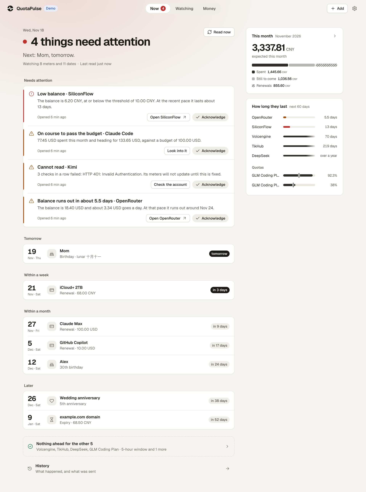
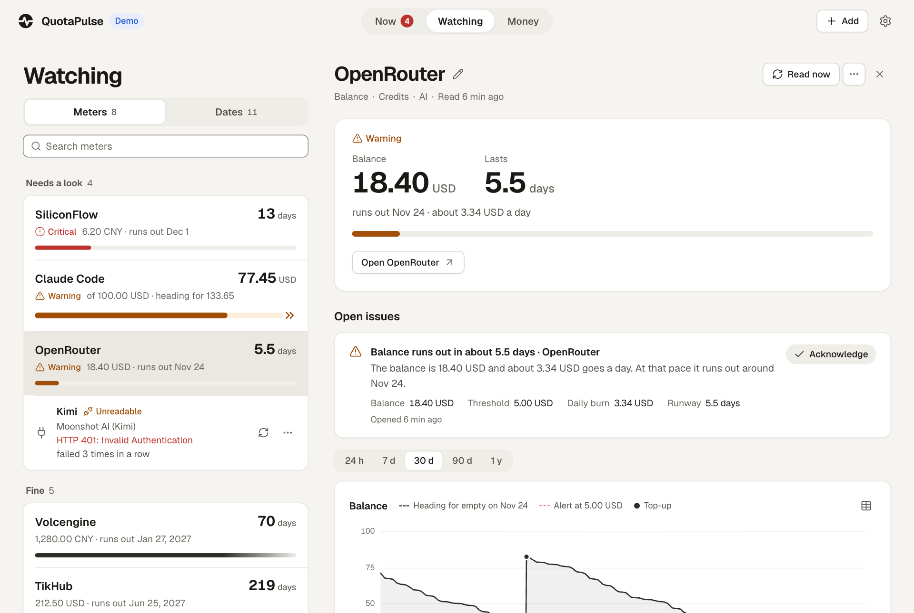
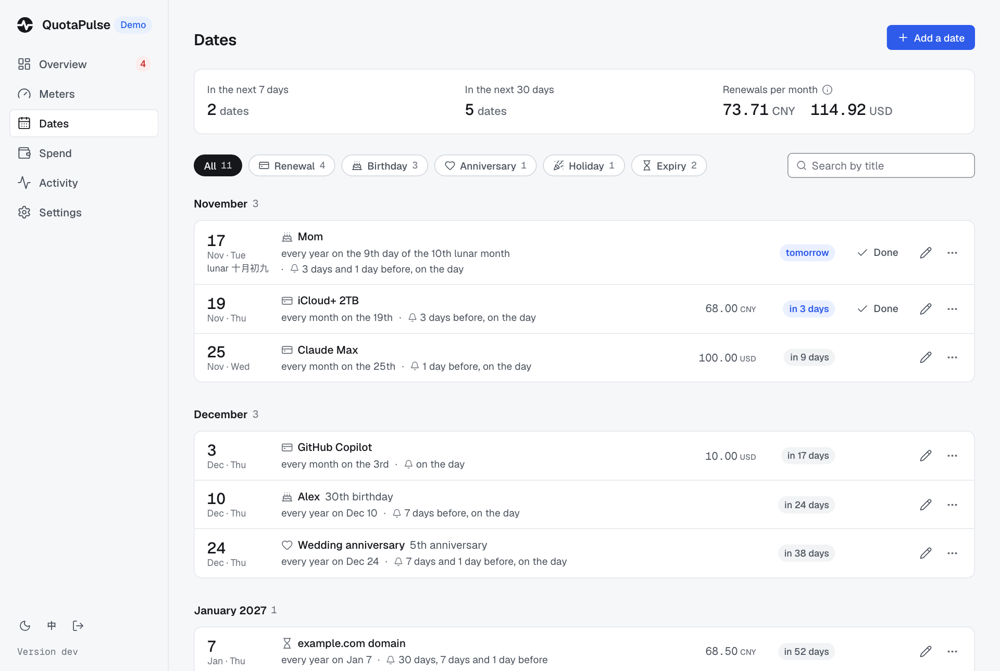

# QuotaPulse

[](https://github.com/itswl/quotapulse/actions/workflows/ci.yml)
[](https://github.com/itswl/quotapulse/releases)

**Tells you before something you depend on runs out or comes due.**

A small self-hosted service that watches two kinds of things:

- **things that run out** — prepaid API balances, plan quotas that reset, what a
  tool has cost this month — and works out *how long each will last*;
- **things that come due** — renewals, expiries, birthdays, on the solar or the
  Chinese lunar calendar.

It says something when that changes: when a balance is on course to run out, when
it gets worse, when it recovers, when a date is near. Not every morning. One
binary, one SQLite file, a dashboard, and an MCP endpoint so your agents can ask it
too.

[简体中文](README.zh-CN.md)



## What it does

**It forecasts instead of comparing to a threshold.** "430 left" means little; "at
this pace, gone on the 22nd" is something to act on. The burn rate weights recent
days more, so a one-off job fades and a new habit shows up within days. A
threshold is still there as a last line.

**It knows a quota from a balance.** A coding plan's five-hour window and its
monthly tool quota are separate meters, each with its reset time — and with the
window's length known, whether it will last until it resets.

**It notices a leak without crying wolf.** A burst of spend becomes an incident
only if it is both a real jump *and* fast enough to empty the balance within days.
Spending 2.50 after a quiet week is not news on a balance of 500.

**It speaks on change.** An incident opens, may escalate, and resolves; those are
the messages. A warning is said once. Only an unacknowledged *critical* incident
repeats. Quiet hours hold back what can wait, and a problem that fixes itself
overnight is never announced.

**Dates, with the lunar calendar done properly.** Weekly, monthly, yearly, every
N, one-off. A lunar birthday lands on the right day every year, including the
ones whose month is a day short.

| | |
| --- | --- |
|  |  |

**It tells you where you are.** Feishu/Lark, DingTalk, WeCom, Slack, Telegram,
ntfy, Bark, a plain webhook, or the browser itself. Each channel picks its topics
and how severe something must be. Delivery is retried from an outbox, and a
channel that keeps failing is itself reported — through the others.

**Agents can ask — and act.** `/mcp` gives an AI agent "what needs attention" and
"does this account have headroom" before it starts a large job, and, under a scoped
token, everything the dashboard can do.

**Anything can report in.** No API for it? Push the number:
`POST /api/v1/ingest`. A pushed meter gets the same forecast and rules.

## Try it

No credentials needed — the demo runs the real engine against a fake internet:

```bash
docker run --rm -p 8080:8080 ghcr.io/itswl/quotapulse demo
# http://localhost:8080, password: demo
```

## Run it

One file, and nothing to set:

```bash
curl -fsSLO https://raw.githubusercontent.com/itswl/quotapulse/main/docker-compose.yml
docker compose up -d
```

Open http://localhost:8080 — or the server's own address — and choose a password;
the language and time zone are filled in from your device. Then add an account, a
notification channel and a date. Everything is configured in the dashboard.

- **Set it up within the hour.** A new install is set up by whoever opens it
  first, for an hour after it starts. After that, or once it holds anything, it
  takes the one-time link in its log: `docker compose logs quotapulse`.
- **Forgot the password?**
  `docker compose exec quotapulse /quotapulse reset-password` prints a link to
  choose a new one.
- **Upgrading.** Images are published for amd64 and arm64 as
  `ghcr.io/itswl/quotapulse`, and the compose file follows the 1.x line:
  `docker compose pull && docker compose up -d` brings the newest 1.x. To hold
  one release, put `QUOTAPULSE_VERSION=1.3.1` in a `.env` next to it.
- **The data directory** is `./data`. The container starts as root only to take
  it over, then runs as whoever owns it — 65532, the image's own user, for a new
  one. `QUOTAPULSE_USER=$(id -u):$(id -g)` in `.env` runs it as you instead.
- **From source:**
  `docker compose -f docker-compose.yml -f docker-compose.build.yml up -d --build`.
  Without Docker: `npm --prefix web ci && npm --prefix web run build`, then
  `go build ./cmd/quotapulse` and `./quotapulse`.
- **Put TLS in front** before exposing it beyond the machine; any reverse proxy
  will do. The dashboard's live updates are a long-lived response, so do not
  buffer it.

### Settings from the environment

All optional: what to watch, where to notify and how to behave live in the
database and are edited in the dashboard.

| Variable | Default | |
| --- | --- | --- |
| `QUOTAPULSE_PASSWORD` | chosen in the dashboard | The password, set here instead; the dashboard then cannot change it |
| `QUOTAPULSE_DATA` | `./data` (`/data` in the image) | The database, its daily backups, and the key file |
| `QUOTAPULSE_LISTEN` | `:8080` | |
| `QUOTAPULSE_SECRET` | a key file in the data directory | Encrypts stored credentials. Set once; never change it |
| `QUOTAPULSE_BOOTSTRAP` | — | A [bundle](docs/bundle.md) to import into an empty database |
| `QUOTAPULSE_MUTE` | — | `1` records notifications without sending them |
| `QUOTAPULSE_LOG`, `QUOTAPULSE_LOG_LEVEL` | `text`, `info` | `json` for structured logs |
| `TZ`, `QUOTAPULSE_LANG` | asked when it is set up | Time zone and language (`en`, `zh`) of a **new** install, instead of asking; change them later in the dashboard |

## Platforms

Built in: DeepSeek, Zhipu GLM Coding Plan, OpenRouter, SiliconFlow, Moonshot
(Kimi), Volcengine, Alibaba Cloud, TikHub and UniAPI.

A platform is one HTTP request and one jq expression, so adding yours takes a few
lines and no code — in the dashboard, with a live test against your own key. See
[docs/providers.md](docs/providers.md), which also says how each built-in
definition was verified.

## Agents

Create a token under **Settings → Tokens** (`read` is enough to ask; add `act` to
let an agent change dates or acknowledge incidents, `ingest` to report readings,
`admin` for everything else) and point an MCP client at `/mcp`:

```json
{"mcpServers": {"quotapulse": {"type": "http", "url": "https://pulse.example/mcp",
  "headers": {"Authorization": "Bearer qp_…"}}}}
```

| | |
| --- | --- |
| `attention` | What is open right now and what is coming up. Start here |
| `list_meters`, `get_meter` | Every meter with its forecast and a one-word `headroom`: `ok`, `low`, `exhausted`, `unknown` |
| `list_dates`, `get_spend`, `list_activity` | Dates, a month of spend, incident history |
| `add_date`, `complete_date`, `acknowledge`, `sample_now` | With the `act` scope |
| `record_reading` | With the `ingest` scope |

The tools say what they return. When to call them, and how to read the answers
honestly, is in a skill: [`.agents/skills/quotapulse`](.agents/skills/quotapulse/SKILL.md).
For example, a runway is a forecast and a quota is not money. The skill also
checks an account before a costly job and turns "Mom's lunar birthday" into the
right rule. Install it with `npx skills add itswl/quotapulse`, or copy the
directory into your agent's skills folder.

## Reporting from a script

```bash
curl -X POST https://pulse.example/api/v1/ingest \
  -H "Authorization: Bearer qp_…" -H "Content-Type: application/json" \
  -d '{"meter": "claude-code", "kind": "counter", "unit": "USD", "value": 61.75}'
```

[`scripts/claude-code-usage.py`](scripts/claude-code-usage.py) reports what Claude
Code has cost this month; run it from cron. Give the meter a monthly budget to be
warned when the month is heading past it, and a "silent for" limit to hear when the
script stops running.

## Backups

The database is backed up into `data/backups/` once a day; the last seven are
kept. For a copy you can read, or to move to another machine:

```bash
docker compose exec quotapulse /quotapulse export --secrets > backup.json
```

Everything is in the data directory. Back it up as a whole — the key file with
it, or the stored credentials cannot be read.

## More

- [docs/API.md](docs/API.md) — the HTTP API, the webhook payload, Prometheus metrics
- [docs/providers.md](docs/providers.md) — reading a platform
- [docs/bundle.md](docs/bundle.md) — export, import, and starting from a file
- [docs/ARCHITECTURE.md](docs/ARCHITECTURE.md) — how it is built, and why
- [docs/migrating-from-0.x.md](docs/migrating-from-0.x.md) — coming from an earlier version

## Development

```bash
npm --prefix web ci && npm --prefix web run build
go test -race ./...
(cd tools/legacy-import && go test -mod=mod ./...)
npm --prefix web run typecheck && npm --prefix web test

go run ./cmd/quotapulse demo --lang zh                        # try a change
QUOTAPULSE_WEB_DIR=web/dist go run ./cmd/quotapulse demo      # with `npm --prefix web run watch` alongside
```
