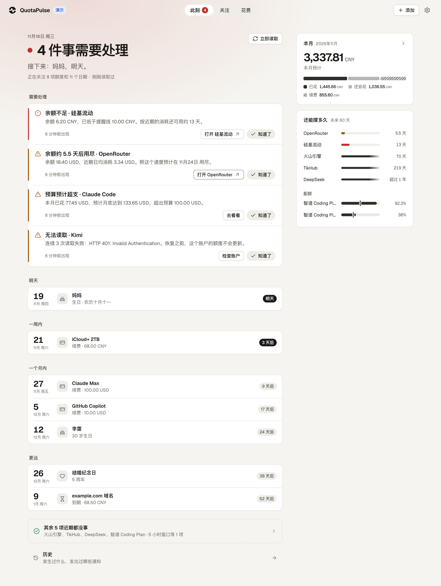
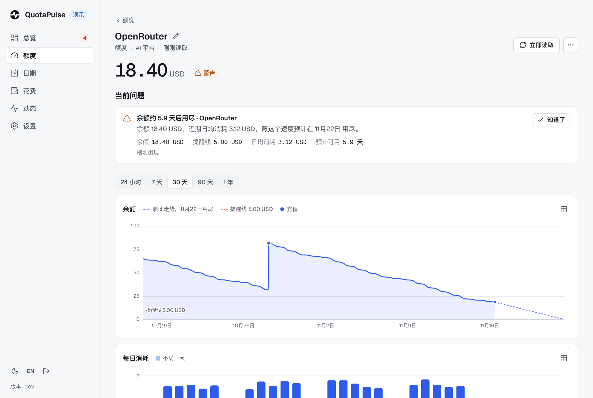
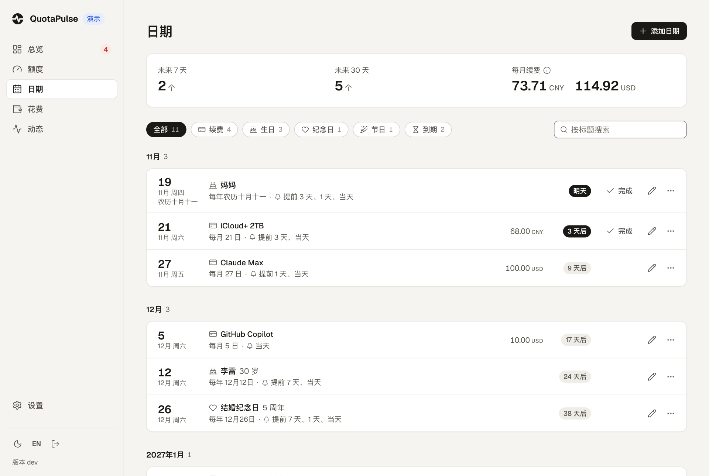

# QuotaPulse

[](https://github.com/itswl/quotapulse/actions/workflows/ci.yml)
[](https://github.com/itswl/quotapulse/releases)

**在你依赖的东西用完或到期之前告诉你。**

一个自托管的小服务，盯两类东西：

- **会用完的** —— 预付的 API 余额、会重置的套餐配额、某个工具这个月花了多少 ——
  并算出*每一样还能撑多久*；
- **会到期的** —— 续费、到期日、生日，公历农历都行。

情况有变化时它才说话：余额照这个速度要见底了、情况变糟了、恢复了、日子快到了。
而不是每天早上重复一遍。一个二进制、一个 SQLite 文件、一个看板，外加一个 MCP
端点，让你的 Agent 也能来问。

[English](README.md)



## 它做什么

**预测，而不是跟阈值比大小。** "还剩 430"说明不了什么；"照这个速度 22 号用完"才是
可以行动的信息。日均消耗的算法里近期权重更高，所以一次性的批量任务会逐渐淡出，
新的使用习惯几天内就能反映出来。阈值仍然保留，作为最后一道防线。

**分得清配额和余额。** 编程套餐的 5 小时窗口和每月的工具额度是两个独立的额度，
各有自己的重置时间；知道窗口多长，就能判断它撑不撑得到重置。

**能发现泄露，又不乱报。** 一阵突增的消耗只有同时满足两点才算事件：确实比平时
快了好几倍，*并且*照这个速度几天内余额就没了。安静了一周后花掉 2.5 块，对一个
500 块的余额来说不是新闻。

**有变化才通知。** 事件会开启、可能升级、最后恢复，通知就发生在这几个节点上。
警告只说一次；只有没人确认的*严重*事件才会每天提醒。免打扰时段里能等的都顺延，
夜里自己恢复了的问题不会再通知你。

**日期，农历也算对。** 每周、每月、每年、每隔 N 个周期、一次性。农历生日每年都
落在正确的那天，包括当月少一天的年份（腊月三十在只有二十九天的年份落在除夕）。

| | |
| --- | --- |
|  |  |

**在你看得到的地方通知你。** 飞书、钉钉、企业微信、Slack、Telegram、ntfy、Bark、
普通 Webhook，或者浏览器本身。每个渠道可以选主题、选严重级别。投递走发件箱并自动
重试；一个渠道连续失败，会通过其他渠道告诉你。

**Agent 可以来问。** `/mcp` 让 AI Agent 在开始一个大任务之前，用一把限定权限的
令牌问清楚"现在有什么需要关注"和"这个账户还有余量吗"。

**什么都可以上报。** 平台没有接口？把数字推过来就行：`POST /api/v1/ingest`。
上报的额度享有同样的预测和规则。

## 先试试

不需要任何密钥 —— 演示模式用真正的引擎对着一个假的互联网跑：

```bash
docker run --rm -p 8080:8080 ghcr.io/itswl/quotapulse demo --lang zh
# 打开 http://localhost:8080，密码：demo
```

## 部署

一个文件，什么都不用设：

```bash
curl -fsSLO https://raw.githubusercontent.com/itswl/quotapulse/main/docker-compose.yml
docker compose up -d
```

打开 http://localhost:8080（或者服务器自己的地址），选一个密码；语言和时区已经
按你的设备填好了。然后添加一个账户、一个通知渠道、一个日期。所有配置都在看板里完成。

- **一小时内完成设置。** 新装的实例启动后一小时内，谁先打开谁来设置。超过一小时，
  或者里面已经有东西了，就要用日志里的一次性链接：`docker compose logs quotapulse`。
- **忘了密码？** 运行
  `docker compose exec quotapulse /quotapulse reset-password`，它会给出一个重新选
  密码的链接。
- **升级。** 镜像发布在 `ghcr.io/itswl/quotapulse`，支持 amd64 和 arm64。compose 文件
  跟着 1.x 走：`docker compose pull && docker compose up -d` 会拉到最新的 1.x。想停在
  某个版本，就在旁边的 `.env` 里写上 `QUOTAPULSE_VERSION=1.3.1`。
- **数据目录**是 `./data`。容器只为了接管它才以 root 启动，随后就以目录主人的身份
  运行——新目录交给镜像自己的用户 65532。在 `.env` 里设
  `QUOTAPULSE_USER=$(id -u):$(id -g)`，就以你自己的身份运行。
- **从源码构建：**
  `docker compose -f docker-compose.yml -f docker-compose.build.yml up -d --build`。
  不用 Docker：`npm --prefix web ci && npm --prefix web run build`，然后
  `go build ./cmd/quotapulse`，再 `./quotapulse`。
- **对外暴露之前先在前面加一层 TLS**，任何反向代理都行。看板的实时更新是一个
  长连接响应，不要给它开缓冲。

### 环境变量

全都可以不设：关注什么、通知发到哪里、怎样提醒，都存在数据库里，在看板上改。

| 变量 | 默认值 | |
| --- | --- | --- |
| `QUOTAPULSE_PASSWORD` | 在看板里选 | 在这里设登录密码；这样看板里就改不了它 |
| `QUOTAPULSE_DATA` | `./data`（镜像里是 `/data`） | 数据库、每日备份和密钥文件都在这里 |
| `QUOTAPULSE_LISTEN` | `:8080` | |
| `QUOTAPULSE_SECRET` | 数据目录里的密钥文件 | 用来加密保存的凭据。设一次，之后不要改 |
| `QUOTAPULSE_BOOTSTRAP` | — | 数据库为空时导入的[配置包](docs/bundle.md) |
| `QUOTAPULSE_MUTE` | — | 设为 `1` 时通知只记录、不发送 |
| `QUOTAPULSE_LOG`、`QUOTAPULSE_LOG_LEVEL` | `text`、`info` | `json` 输出结构化日志 |
| `TZ`、`QUOTAPULSE_LANG` | 设置时询问 | **全新安装**的时区和语言（`en`、`zh`），设了就不再询问；之后在看板里改 |

## 支持的平台

内置：DeepSeek、智谱 GLM Coding Plan、OpenRouter、硅基流动、月之暗面 Kimi、
火山引擎、阿里云、TikHub、UniAPI、微信排名。

一个平台就是一个 HTTP 请求加一段 jq 表达式，所以接入你自己的平台只要几行、不用
写代码 —— 在看板里完成，还能用你自己的 Key 当场测试。详见
[docs/providers.md](docs/providers.md)，那里也写明了每个内置定义是怎么验证的。

## 给 Agent 用

在 **设置 → 访问令牌** 里创建一个令牌（只是查询的话 `read` 就够；想让 Agent 能
添加日期、确认事件，再加上 `act`），然后把 MCP 客户端指向 `/mcp`：

```json
{"mcpServers": {"quotapulse": {"type": "http", "url": "https://pulse.example/mcp",
  "headers": {"Authorization": "Bearer qp_…"}}}}
```

| | |
| --- | --- |
| `attention` | 现在有什么没解决、接下来有什么日子。从这里开始 |
| `list_meters`、`get_meter` | 每个额度的预测，以及一个词的余量判断 `headroom`：`ok`、`low`、`exhausted`、`unknown` |
| `list_dates`、`get_spend`、`list_activity` | 日期、某个月的花费、事件历史 |
| `add_date`、`complete_date`、`acknowledge`、`sample_now` | 需要 `act` 权限 |
| `record_reading` | 需要 `ingest` 权限 |

## 用脚本上报

```bash
curl -X POST https://pulse.example/api/v1/ingest \
  -H "Authorization: Bearer qp_…" -H "Content-Type: application/json" \
  -d '{"meter": "claude-code", "kind": "counter", "unit": "USD", "value": 61.75}'
```

[`scripts/claude-code-usage.py`](scripts/claude-code-usage.py) 会上报 Claude Code
本月的花费，挂在 cron 里跑就行。给这个额度设一个月度预算，本月有超支趋势时会提醒
你；再设一个"多久没上报就提醒"，脚本停了你也会知道。

## 备份

数据库每天备份一次到 `data/backups/`，保留最近七份。想要一份看得懂的副本，或者
搬到另一台机器：

```bash
docker compose exec quotapulse /quotapulse export --secrets > backup.json
```

所有东西都在数据目录里。备份时整个目录一起备 —— 包括密钥文件，否则保存的凭据
解不开。

## 更多

- [docs/API.md](docs/API.md) —— HTTP 接口、Webhook 负载、Prometheus 指标
- [docs/providers.md](docs/providers.md) —— 如何接入一个平台
- [docs/bundle.md](docs/bundle.md) —— 导出、导入，以及从文件启动
- [docs/ARCHITECTURE.md](docs/ARCHITECTURE.md) —— 它是怎么设计的，为什么这样设计
- [docs/migrating-from-0.x.md](docs/migrating-from-0.x.md) —— 从旧版本迁移

## 开发

```bash
npm --prefix web ci && npm --prefix web run build
go test -race ./...
(cd tools/legacy-import && go test -mod=mod ./...)
npm --prefix web run typecheck && npm --prefix web test

go run ./cmd/quotapulse demo --lang zh                        # 试一下改动
QUOTAPULSE_WEB_DIR=web/dist go run ./cmd/quotapulse demo      # 配合 `npm --prefix web run watch`
```
